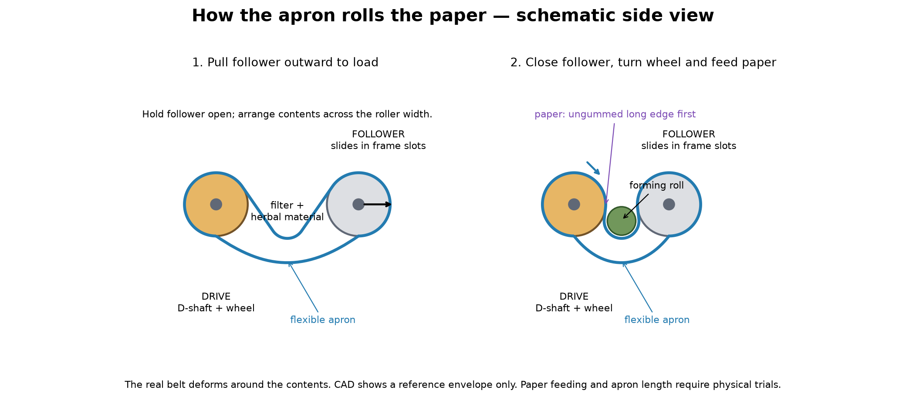

# Desktop herbal paper roller — revision 2

A parametric CadQuery mechanical prototype for **non-tobacco herbal material**, with printable component meshes, individual STEP files, and closed/open assemblies. The default working width is 74 mm. Roller diameter is 16 mm; shaft diameter is 6 mm with a 0.5 mm-deep longitudinal flat.

**Revision 2 replaces the previous shaft with its obstructing integral pin.** The new shaft has a constant D-shaped section that can slide through the entire drive drum and wheel. Separate cotter pins go in only after assembly. Do not mix revision 1 and revision 2 parts: shaft sizes, frame, fits, and roller spacing changed.

This is an untested physical prototype. The CAD checks establish geometry, clearances and selected assembly/motion paths. They do not establish strength, durability, manufacturing safety, material suitability, inhalation safety, or perfect rolling. No physical print, slicer toolpath, torque/strength analysis, or paper rolling test has been performed.

## How it works



The **flexible apron** does the wrapping. The two rigid drums support and move that apron. Neither the wheel nor the shafts directly wrap the paper around the material.

1. **Open the pocket.** Pull the follower drum away from the drive drum, along the slots in the two sides of the frame. It moves 12 mm in the sample design. Both ends must move together; do not deliberately skew the shaft. Hold the follower at a position where the pocket is accessible and has enough slack for the contents; there is no open-position latch. The outer stop gives maximum separation, not a mandatory loading position. The extra loop length allows a pocket in the apron. The belt is flexible and must be arranged by hand; the CAD envelope is not its real working shape.
2. **Load across the width.** Place the filter at one end of the pocket. Distribute the herbal material beside it along the roller axis, not on top of a bare drum. The sample apron is 73 mm wide; leave edge clearance for the paper. Filter, paper, loose material and seam adhesive are consumables, not printed mechanical parts. No particular filter diameter or filling amount is validated.
3. **Close the follower.** Move it toward the fixed drive drum, to the inner ends of both slots. Closed shaft spacing is 24 mm, leaving 8 mm between the bare 16 mm drums. The slack apron folds around the contents and forms a cradle. This gap is not a guaranteed finished-roll diameter. Belt tension tends to pull the drums together, but the design has no independent closed-position lock; hold it closed if needed during trials.
4. **Turn the wheel to settle the contents.** The handwheel's D-hole bears on the shaft's flat. The shaft's flat bears on the matching flat inside the drive drum. This transmits torque without a protruding key or pin inside the drum. The drive drum is intended to move the apron by friction. The apron moves the follower drum, which turns freely around its axle. Slipping means apron friction/tension/material needs development; CAD alone cannot demonstrate grip.
5. **Feed the paper manually.** Present the paper's *ungummed long edge* to the entrance between the apron and the forming roll, keeping the paper square across the working width. Turn the wheel in the direction that draws that edge into the pocket. Start with an empty-paper trial to establish the direction; clockwise depends on which end you look from. The moving apron is intended to draw the paper around the rotating contents. Keep the gummed long edge trailing; finish its seam as required by the paper. This design does not automatically position paper placed anywhere on the device.
6. **Release.** Move the follower outward and ease the finished roll from the flexible pocket. The apron stays looped around the drums.

**Important limitation:** the blue `flexible_apron_reference` in closed CAD is a taut routing envelope to show what wraps around which drum. It is shorter than the proposed working belt and does **not** show its slack pocket, seam or deformation. `assembly_open.step` omits that envelope rather than displaying a physically impossible stretched belt. The schematic above is illustrative, not a simulated contact shape. Paper feed, belt seam, friction, tension and roll quality still require a physical mock-up.

### Apron starting dimensions

Use a flexible sheet loop, not a rigid printed capsule. The sample neutral-axis starting dimensions are:

- Width: **73 mm**.
- Finished loop circumference: **136.46 mm**.
- Lap overlap allowance: **8 mm**.
- Flat blank: **73 × 144.46 × 0.5 mm**.

The generator derives the loop from the open routing length plus 12 mm loading slack; the closed position consequently has 36 mm extra length relative to the taut envelope. These are starting dimensions, not a validated belt specification. A lap seam creates local double thickness and may disturb feeding; its construction must be developed with the chosen flexible material. Do not force the follower to the outer stop if an actual belt is too short or a seam binds. The supplied `apron_cutting_template.step` gives the flat outline as reference tooling; do not print it as the working apron.

## What changed for assembly and printing

| Previous issue | Revision 2 |
|---|---|
| Integral radial pin could not pass through drum | Continuous D-shaft and open-ended D-bore; removable metal cotter pins outside the frame |
| Separate cheeks had no fasteners | One-piece base/lower-bearing frame plus two removable caps, four M3 through-bolts and captive nuts |
| Loose collars had no retention | M6 thrust washers captured by removable split cotter pins |
| Swing arms moved on an arc at constant spacing | Straight captured follower slots provide 12 mm loading travel |
| Crank grip had no dependable retention | M3 bolt, washers and shoulder sleeve clamp together while grip spins on sleeve |
| STLs only translated, not oriented | Shafts flat-side down, caps top-face down, drums/wheel/spacers vertical-axis |

## Print files and orientations

[Download the slicer ZIP](https://github.com/fitu/CAD_TEST/raw/refs/heads/main/outputs/slicer_parts.zip), extract it and import individual STLs into PrusaSlicer at **100%, millimetres**. Use GitHub's **Download raw file**, not Save Page. Do not slice `assembly.step` as one print-in-place object.

The ZIP has **15 mechanical printed components and one fit coupon**. Metal hardware and apron references are deliberately excluded. Model geometry is unchanged by STL orientation; STEP parts remain in assembled coordinates.

| Printed components | Qty | STL orientation / print consideration |
|---|---:|---|
| `frame` | 1 | Base on bed. U-shaped lower bearing saddles and open-bottom nut pockets avoid enclosed horizontal bearing roofs. Sample footprint 118 × 80 mm, height 32 mm. Nut pockets have short roofs; inspect their small bridges in preview. |
| `left_bearing_cap`, `right_bearing_cap` | 2 | Flat top on bed, bearing recesses facing upward. The curved recess is not a bridge in this pose. |
| `drive_shaft`, `follower_shaft` | 2 | Horizontal, 0.5 mm flat down, cotter holes vertical. Flat is about 3.32 mm wide; use a brim if adhesion needs it. Shafts are 124 and 112 mm long. |
| `drive_drum`, `follower_drum` | 2 | Roller axis vertical. 74 mm tall with through bores. Start with about a 6 mm brim; inspect stability and surface quality. Do not flatten the working roller circumference. |
| `left/right_drive/follower_spacer` | 4 | Shaft axis vertical. Each is 5.7 mm long. |
| `wheel_spacer` | 1 | Axis vertical; 6 mm long. |
| `handwheel` | 1 | Broad face on bed; both shaft and crank holes vertical. |
| `crank_sleeve`, `crank_grip` | 2 | Axis vertical. Grip spins on sleeve with 0.3 mm nominal radial and end clearance. |
| `fit_coupon` | 1 | Flat plate down. Three D-holes; see fit check below. Not an assembly part. |

Suggested **starting** slicer settings: 0.4 mm nozzle, 0.2 mm layers, 4 perimeters, and more solid infill for the small shafts. These settings have not been physically validated and do not imply strength. The design minimizes overhangs but is not certified support-free for every printer; inspect every layer, especially nut-pocket bridges and the thin shaft ends. No automatic support setting is forced. Choose materials only after assessing the intended contact and cleaning conditions.

### Fits before a full print

Print the coupon and one shaft first. With the coupon viewed as exported, the D-hole clearances run **0.15 / 0.25 / 0.35 mm from left to right**. The default keyed clearance is 0.25 mm on the curved surface and the flat; plain bearings use 0.30 mm radial clearance. The coupon should slide along the shaft with hand pressure without losing engagement on the flat. Change `keyed_clearance` if required by the machine. Do not scale a whole part to adjust a hole; regenerate the CAD so the other dimensions remain correct. Check a bearing cap and follower-drum bore too. Smooth bearing surfaces only as needed and remove burrs from cotter holes. No press fit is assumed.

The flat on the drive shaft serves both bed contact and torque transmission. The follower shaft also has a bed flat, but its drum has a **round clearance bore** so it can rotate independently. Small flats should be on shafts, not on the drum circumference that contacts the apron.

## Purchase hardware — do not print these substitutes

All hardware has an individual STEP envelope for assembly inspection; threads, cotter eye shapes and bent tails are simplified. `outputs/stl/hardware/` is reference only. Match actual head, nut and washer dimensions before buying or printing the full set.

| Metal item | Qty | Model assumptions |
|---|---:|---|
| M3 × 40 socket-head screws | 4 | 40 mm under head, head Ø5.5 × 3 mm; through caps and frame |
| M3 hex nuts | 5 | 5.5 mm across flats, 2.4 mm thick; four under frame, one crank |
| M6 plain washers | 4 | 6.6 mm ID, 12 mm OD, 1 mm thick; shaft thrust retention |
| 2 mm split cotter pins | 4 | At least 12 mm under-eye length; fit Ø2.2 mm cross holes; bend tails after installing |
| M3 × 25 socket-head screw | 1 | Crank axle, 25 mm under head |
| M3 plain washers | 2 | 3.4 mm ID, 8 mm OD, 0.5 mm thick; each end of crank sleeve |

Frame nuts enter from the underside into 5.9 mm across-flat, 3.5 mm deep hex pockets. They are pulled against the pocket roofs when the screws are tightened. Do not overtighten printed plastic. Recheck actual screw length/head dimensions and cotter interference after assembling; model envelopes do not validate a particular supplier's hardware or thread engagement strength.

## Assembly order — no trapped integral key

1. **Check the fits.** Confirm the coupon/shaft fit, round bores, cotter holes and actual purchased hardware. Leave both bearing caps off the frame. Place the four frame nuts in their underside pockets; temporary tape can hold them in place.
2. **Prepare the apron and drums.** Loop the flexible apron around both bare drums. If using a lap seam, develop and close it before fitting the shafts, or use a removable seam. The proposed belt pattern is only a starting point.
3. **Fit the drive shaft on the bench.** Align its flat with the D-bore and slide it through the full length of the drive drum. The shaft has no raised key or shoulder. With the shaft endpoints matched to the assembly, put one `drive_spacer` on each side of the drum. Leave washers, wheel and cotter pins off for now.
4. **Fit the follower axle.** Slide the follower shaft through the round follower-drum bore. Add its two spacers. The follower drum must spin freely.
5. **Lower both subassemblies into the frame.** Drive shaft goes in the front, fixed U saddles; follower goes in the rear elongated saddles. Spacers are inside the bearing walls, not outside. Shift drums/shafts axially to match the assembled STEP locations. The drum/spacer stack leaves 0.3 mm at each inner frame face. Check no belt edge is trapped.
6. **Retain the follower.** Add one M6 washer outside each side of the frame. Insert a cotter pin in each exposed cross hole, then bend its tails away from the frame to retain it. The cotters are removable hardware, not part of the printed shaft. Verify bent tails clear the frame throughout movement.
7. **Fit the drive wheel and retain the drive shaft.** Add the two outside M6 washers. On the left, add the 6 mm `wheel_spacer` and slide the wheel onto the D-shaft. Add the two drive cotters last, then bend their tails. The shaft's *longer extension goes on the wheel side*. The wheel/spacer/washer stack and right washer are captured between the pins with small nominal endplay; do not clamp the shaft against the bearing faces.
8. **Close the bearings.** Fit each cap on top of its lower frame wall, with recesses down. Insert the four M3×40 screws from above into the captured underside nuts. Tighten evenly. The drive must turn freely and the follower must slide the full slot length with both caps installed. These screws close the bearings; they are not follower-position adjustment screws.
9. **Assemble the crank.** On the M3×25 bolt, install an M3 washer, the sleeve inside the grip, then the second M3 washer. Put the bolt through the wheel's off-centre hole and add the M3 nut on the wheel's inner side. The bolt clamps washers and sleeve to the wheel; it does not clamp the grip. The grip has 0.3 mm end clearance at each end and rotates around the sleeve. Confirm free rotation before use.
10. **Check by hand without material.** Rotate the drive a full turn, spin the follower, move it fully inward/outward, and confirm both shafts are retained. Paper/apron trials follow only after confirming these motions. There is no prescribed torque or strength limit from this CAD model.

Use `outputs/assembly.step` to see closed locations and `outputs/assembly_open.step` to see the follower at the outer stop. The open assembly omits the flexible envelope. There are 36 solids in the closed assembly and 35 in the open assembly; the calibration coupon and flat apron template are excluded from both.

## Generate and test

Python 3.12 / CadQuery 2.6.1 were used for the sample exports. From the existing checkout:

```sh
python -m venv .venv
.venv/bin/python -m pip install -r requirements-lock.txt
PYTHONPATH=src .venv/bin/python -m herbal_roller.generate --config config/sample.json --out outputs
PYTHONPATH=src .venv/bin/python -m herbal_roller.illustrate
PYTHONPATH=src .venv/bin/python -m pytest -q
```

The prepared Codex interpreter is `/workspace/cadquery-venv/bin/python`. No services or credentials are required after installing dependencies. Use the existing isolated checkout; no separate Git worktree is needed.

`requirements.txt` pins direct dependencies and `requirements-lock.txt` captures installed versions. `config/sample.json` documents the geometry; values are mm. Shaft radius and axis height are restricted to 3 and 32 mm in revision 2 to match the fixed hardware. Other dimensions have supported ranges in `load_config`. `outputs/manifest.json` records assembled bounds, **oriented STL bounds**, category and apron starting dimensions for every part.

Generation removes obsolete part exports listed in the previous manifest so revision 1 components cannot remain in the new ZIP. Avoid manually editing generator-owned exports.

The automated checks cover single valid solids, dimensions, pairwise closed-assembly solid interference, the full continuous axial D-shaft insertion envelope, lowering shaft/drum/spacer subassemblies into an uncapped frame, sampled follower travel and crank rotation, planar print contact, STEP re-import, mesh watertightness/connectedness/volume/scale, ZIP contents, invalid configurations and an alternative configuration. Motion checks exclude flexible belt contact and do not simulate friction, flexible deformation, bent cotters, wear, loads or print variation. They provide geometric evidence, not physical verification.

## Inspect in a browser

Download `assembly.step` or `assembly_open.step` using GitHub's raw-file download. Upload it to [Autodesk Viewer](https://viewer.autodesk.com/) (sign-in may be required). Review the service's data terms for private files. Hide the blue apron reference to inspect the shafts and spacers. Isolate frame/caps, section the drive drum to see the continuous D-bore, and compare open/closed assemblies to see the straight follower travel. Hardware names begin with `hw_`; print those only as display models, never as substitutes for the metal parts.

The browser viewer is optional and was not used to validate the exports; automated validation uses OpenCascade re-import and mesh checks. STEP stays available for CAD editing; use the oriented STL ZIP for PrusaSlicer.
